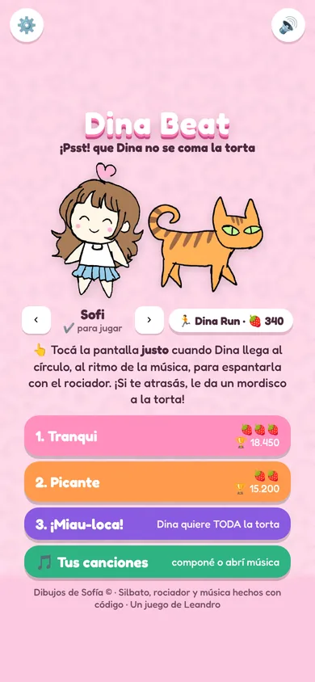
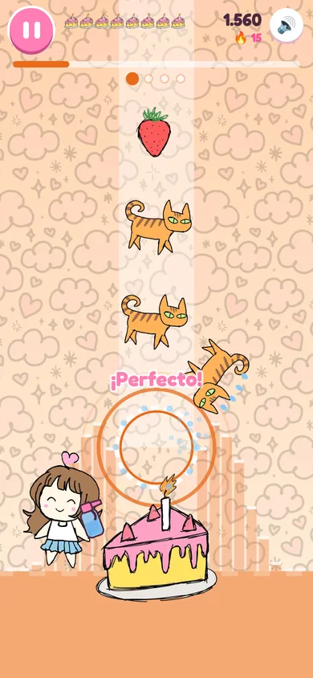
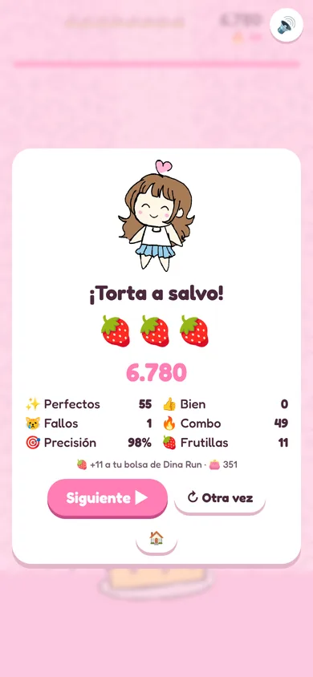
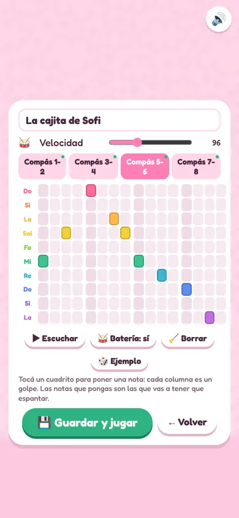
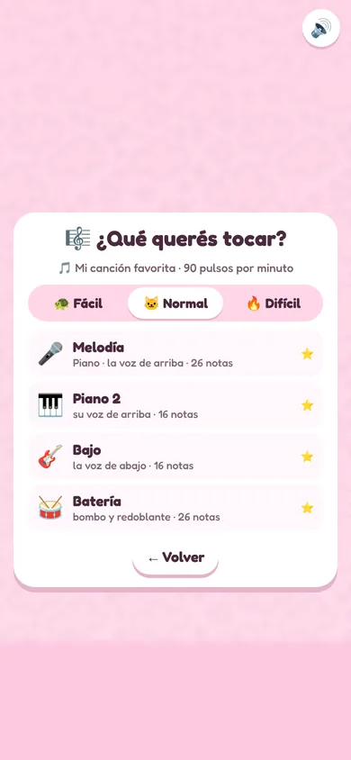
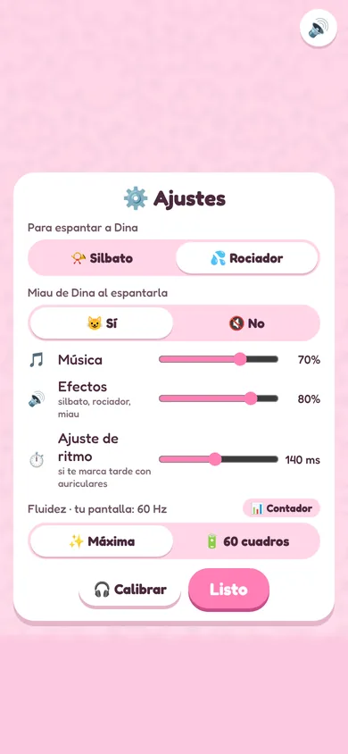
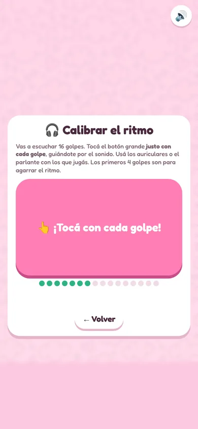

# Dina Beat

🎮 **Jugar:** https://kiut-studio.github.io/dina-beat/

Juego de ritmo con los dibujos de Sofía. Dina baja a comerse la torta al ritmo de la música: tocá la pantalla **justo** cuando llega al círculo para espantarla con el rociador (¡Psst!) o el silbato (¡Piii!). Si te atrasás, le da un mordisco.

  
  
  

## Cómo se juega
- 3 etapas que se ponen más difíciles: **Tranqui** (96 pulsos por minuto), **Picante** (112) y **¡Miau-loca!** (128). Se abre la siguiente al pasar la anterior.
- La torta tiene 8 porciones; cada 8 aciertos recuperás una.
- Puntaje con combo, de 1 a 3 🍓 según la precisión, y récord por etapa.
- ✨ Visualizador: un ecualizador que baila con la música, un anillo que se cierra sobre el círculo justo cuando hay que tocar, un metrónomo con los tiempos del compás, y Sofi, la torta y Dina que se mueven al pulso.
- En el teléfono se toca la pantalla; en la PC, espacio o Enter. Esc o P pausa, y al volver hay una cuenta 3-2-1 al ritmo de la canción.

## 🎵 Tus canciones

  
  

- Componé tu propia melodía (8 compases, velocidad y batería) y jugala.
- O jugá con un archivo tuyo: música (mp3, m4a, wav, ogg), con detección automática de los golpes y del pulso, o una partitura MIDI (.mid), donde elegís qué tocar: melodía, bajo, batería o cada instrumento.
- El archivo se lee solo en tu dispositivo y no se sube a ningún lado. Cada jugador usa la música que tiene permiso para usar.
- Dificultad Fácil, Normal y Difícil.

## ⚙️ Ajustes

  
  

- Rociador o silbato, miau de Dina sí o no, volumen de música y de efectos.
- **🎧 Calibrador de ritmo:** tocás con 16 golpes y el juego calcula cuánto atraso tienen tu teléfono, parlante o auriculares (los Bluetooth suelen atrasar entre 150 y 250 ms).
- **Fluidez:** se ve suave en pantallas de 90, 100, 120 Hz o más. Se puede limitar a 60 cuadros para ahorrar batería, y prender un 📊 contador de cuadros por segundo.

## Junto con Dina Run
Dina Beat es hermano de [Dina Run](https://github.com/Kiut-Studio/dina-run). Como los dos juegos están en el mismo sitio (`kiut-studio.github.io`):
- Podés tocar con los personajes que compraste en Dina Run (Deisy, Leandro, Nora, Cinthia; Sofi siempre).
- Las frutillas que juntás en Dina Beat se suman a tu bolsa de Dina Run.
- Lo que tenés puesto allá (ropa, sombreros, confeti) y los disfraces de Dina del Pase de Halloween se ven también acá.

## Temas
En ⚙️ Ajustes → 🎨 Temas: según la fecha (Halloween del 15/10 al 2/11), Clásico, Halloween o 🫧 Frutiger Aero. En Halloween la torta es la calabaza con golosinas de Sofía y hay murciélagos, golosinas y disfraces. Frutiger Aero trae cielo celeste, burbujas de vidrio, pasto brillante y cuatro canciones propias con campanitas.

El progreso se guarda solo en el dispositivo y navegador donde jugás.

Se puede instalar como app desde el menú del navegador ("Agregar a pantalla de inicio") y funciona sin conexión.

## Créditos
- Dibujos: **Sofía** © (Sofi, Deisy, Leandro, Nora, Cinthia, Dina, la torta, frutilla, pancito, el fondo de nubes, los disfraces de Dina, Dina comiendo la calabaza y la calabaza con golosinas, que es un recorte de ese dibujo).
- Con ayuda de IA sobre dibujos de Sofía (como en Dina Run): el vestido de Alicia y las golosinas de Halloween. Los murciélagos, la luna y las calabacitas del fondo, y las burbujas, el sol y las cintas de luz de Frutiger Aero están hechos con código.
- El silbato y el rociador son dibujos provisorios hechos con código; la música, el rocío y el miau también se hacen con código.
- Código: Leandro, con asistencia de IA. Licencia MIT solo para el código (ver [LICENSE](LICENSE)); los dibujos no se pueden reutilizar sin permiso de Sofía.
- Inspirado en la idea de juego de ritmo de *Break Whistle*. Antes se llamaba *Sofi Silbato*.

## Para desarrollar
Todo el juego está en `index.html` (HTML5 + canvas, sin dependencias). Las novedades de cada versión están en [CHANGELOG.md](CHANGELOG.md) y las decisiones técnicas en [CONTEXTO.md](CONTEXTO.md). Las pruebas automáticas están en [`pruebas/`](pruebas/README.md).
